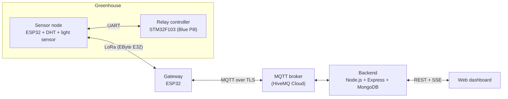

# Greenhouse Farm Management System

A LoRa-based system that monitors and controls greenhouses: ESP32 and STM32 nodes in the field, an ESP32 gateway that bridges LoRa to MQTT, and a Node.js + MongoDB backend with a web dashboard.

Graduation project (2026), team of 2.


## Features

- Monitor temperature, humidity and light of each greenhouse in real time.
- Control fans, pumps and lights through relays, manually or on a schedule.
- Threshold alerts when temperature, humidity or light leaves its safe range; alerts appear on the dashboard in real time.
- Long-range LoRa link between field nodes and the gateway, with acknowledgements and retries.
- Gateway registration over MQTT; the registration state is stored in flash, so a reboot does not require registering again.
- Web dashboard: projects, greenhouses, devices, alerts, live relay status, user account.
- Authentication with JWT, hashed passwords, 6-digit email OTP for password recovery, and optional Google / GitHub sign-in.

## System architecture



| Link | Protocol | Content |
|------|----------|---------|
| Node ⇄ Gateway | LoRa, compact binary frames | Sensor data, control commands, acknowledgements |
| Gateway ⇄ Server | MQTT over TLS (port 8883) | Sensor data as JSON, commands, heartbeat |
| Server ⇄ Browser | REST API and Server-Sent Events | Data, control, live relay status |

### MQTT topics

`{GATEWAY_MAC}` is the WiFi MAC address of the gateway ESP32, printed on the serial monitor at start-up.

| Topic | Direction | Purpose |
|-------|-----------|---------|
| `{GATEWAY_MAC}/commands` | Server → Gateway | Control commands |
| `{GATEWAY_MAC}/node_data` | Gateway → Server | Sensor data from nodes |
| `{GATEWAY_MAC}/node_response` | Gateway → Server | Result of a command |
| `{GATEWAY_MAC}/online` | Gateway → Server | Heartbeat, every 180 s |
| `{GATEWAY_MAC}/config` | Server → Gateway | Registration confirmation, ping, reset |
| `<namespace>/<registration-code>/newgateway` | Gateway → Server | Gateway registration |

## Hardware

| Part | Role |
|------|------|
| ESP32 DevKit (gateway) | LoRa ⇄ WiFi/MQTT bridge, WiFi set-up through a captive portal (WiFiManager) |
| ESP32 DevKit (node) | Reads sensors, talks LoRa, forwards control commands to the STM32 |
| STM32F103C8 "Blue Pill" | Switches the relays (light, pump, fan) |
| EByte E32 LoRa module | UART LoRa link: channel `0x17`, 2.4 kbps air rate, 20 dBm |
| DHT sensor | Temperature and humidity |
| Analog light sensor | Light level |
| Relay board | Switches the fan, pump and light |


## Reliability on the LoRa link

- Compact binary frames (field id, type, value) built with a small custom `ProtoCodec` shared by the gateway and both nodes.
- Every command is acknowledged by the node; the gateway retries when no answer arrives (up to 3 retries, 4 s timeout).
- WiFi and MQTT reconnect automatically on the gateway, and a heartbeat is published every 180 s.

## Backend

Stack: Node.js, Express, MongoDB (Mongoose), MQTT.js, JWT, bcrypt, Server-Sent Events. The architecture is MVC.

- **REST API** under `/v1` for nine collections: `users`, `gateways`, `nodes`, `devices`, `sensors`, `schedules`, `conditions`, `newGateways`, `notifies`. Requests carry an `x-api-key` header, and user routes use JWT.
- **MQTT handler** subscribes to gateway topics, stores sensor data and publishes control commands.
- **Scheduler** checks schedules every 15 s and sends a command only when a device state differs from the schedule.
- **Threshold alerts**: every new sensor reading is checked against fixed safe ranges; a breach creates a notification that is pushed live to the dashboard (the latest 50 per node are kept).
- **SSE hub** pushes relay acknowledgement or timeout to the browser without polling.

## Project structure

```
.
├── backend/
│   ├── server.js            # Express app, MongoDB, API mount
│   ├── mqttHandler.js       # MQTT subscriber / publisher
│   ├── scheduler.js         # schedule engine
│   ├── sseHub.js            # realtime channel to the browser
│   ├── models/  controllers/  routes/  lib/  scripts/
│   ├── frontend/            # web dashboard, served by Express
│   └── .env.example
└── firmware/
    ├── Gateway/             # ESP32: LoRa ⇄ MQTT bridge
    ├── Node/                # ESP32: sensors and LoRa
    └── NodeControl/         # STM32F103: relay control
```

## Getting started

### Backend and dashboard

Requirements: Node.js 18 or later, MongoDB Community running locally.

```bash
cd backend
cp .env.example .env        # then edit the values
npm install
npm run seed                # generate sample data (db.json)
npm run seed:mongo          # load it into MongoDB
npm start
```

Open `http://localhost:4000`. The API is at `http://localhost:4000/v1`.

Environment variables (see `.env.example`):

| Variable | Description |
|----------|-------------|
| `PORT` | HTTP port, default `4000` |
| `MONGODB_URI` | MongoDB connection string |
| `API_KEY` | Value expected in the `x-api-key` header |
| `MQTT_HOST`, `MQTT_PORT`, `MQTT_USERNAME`, `MQTT_PASSWORD` | MQTT broker (HiveMQ Cloud) |
| `JWT_SECRET` | Secret used to sign tokens |
| `GOOGLE_CLIENT_ID`, `GOOGLE_CLIENT_SECRET`, `GITHUB_CLIENT_ID`, `GITHUB_CLIENT_SECRET`, `OAUTH_BASE_URL` | Optional social sign-in |
| `RESEND_API_KEY`, `RESEND_FROM` | Optional email delivery for OTP codes |

### Firmware

Requirements: [PlatformIO](https://platformio.org/) (VS Code extension or CLI).

| Folder | Board | Upload |
|--------|-------|--------|
| `firmware/Gateway` | ESP32 DOIT DevKit v1 | USB |
| `firmware/Node` | ESP32 DOIT DevKit v1 | USB |
| `firmware/NodeControl` | STM32F103C8 (Blue Pill) | ST-Link |

1. In `firmware/Gateway/src/mqtt.h`, set your own `MQTT_BROKER`, `MQTT_USERNAME`, `MQTT_PASSWORD` and registration code.
2. In each `platformio.ini`, set `upload_port` and `monitor_port` to your COM port.
3. Build and upload with PlatformIO. Libraries are installed automatically from `platformio.ini`.
4. On first boot, the gateway opens a WiFi set-up page; connect it to your WiFi, then add it from the dashboard.

## My role

I worked on the backend, the MQTT data flow, the web dashboard and the hardware assembly.
My teammate, Trần Trung Hiếu, built the hardware.

## Authors

- Phạm Minh Tiến
- Trần Trung Hiếu

